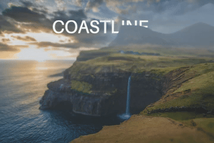
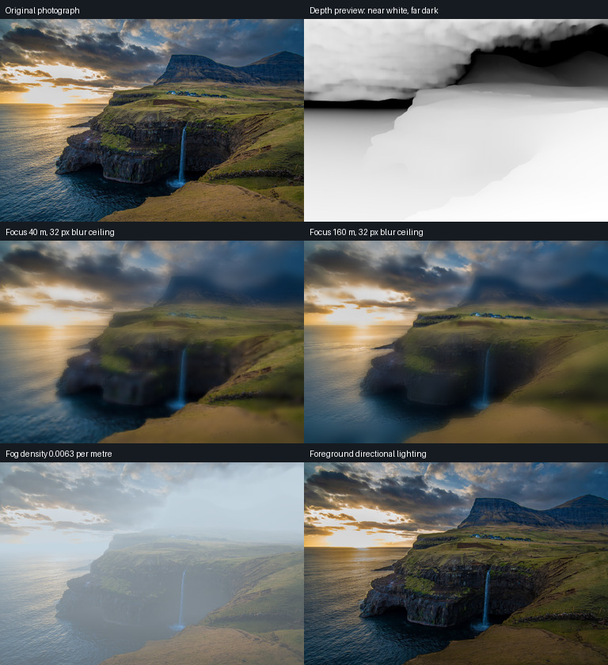

# Cached depth and depth effects

Extract depth once, then reuse it for focus changes, fog, lighting, small
parallax moves, and text hidden behind foreground geometry. The bundled
example uses the existing waterfall photograph and a verified depth asset.



## Run the bundled example

From the repository root:

```bash
uv sync --frozen
uv run pic2panning run examples/compose-depth.json
```

This writes `waterfall-depth-motion.mp4`, a three-second, 768×512 video at
20 fps. It uses the core install and FFmpeg. Rendering cached depth needs
no model weights, Torch, or MLX. The title moves behind the cliff while
focus shifts from 40 to 160 estimated metres.

The bundled [MP4](../examples/media/depth/waterfall-depth-motion.mp4) keeps
all 60 frames. The GIF shows the full three seconds at 10 fps.

The [composition request](../examples/compose-depth.json) contains the
complete camera, text, and effect settings. Its `waterfall` image layer
references `examples/media/depth/waterfall-depth.depth.json`. The title's
`occlusion.layer_id` selects that image layer. Geometry nearer than its
800-metre plane hides the text, with a two-metre feather. The semantic
foreground mask keeps sky pixels clear.

## Extract another asset

```bash
uv run --extra camera pic2panning run examples/depth.json
```

The [depth request](../examples/depth.json) uses pinned MoGe-2 weights on
MPS, 1,800 inference tokens, and a maximum image edge of 768 pixels. The
first extraction downloads the verified checkpoint when it is absent.
Set `device` to `cpu` explicitly for CPU inference. Device and model
failures surface directly.

For an output named `waterfall-depth.tiff`, extraction publishes:

| Artifact | Contents |
| --- | --- |
| [Float TIFF](../examples/media/depth/waterfall-depth.tiff) | Exact float32 camera-space Z estimates in metres |
| [Depth preview](../examples/media/depth/waterfall-depth.preview.png) | Sixteen-bit visualization, near white and far dark |
| [Normals](../examples/media/depth/waterfall-depth.normals.png) | Camera-facing normals derived from depth, encoded as RGB |
| [Foreground mask](../examples/media/depth/waterfall-depth.mask.png) | White semantic foreground; sky excluded |
| [Manifest](../examples/media/depth/waterfall-depth.depth.json) | Source and artifact checksums, dimensions, calibration, model identity, and preview bounds |

The PNG depth preview maps foreground percentiles to its display range.
Read the float TIFF for measurements and effects. The manifest records
that display range separately from the metric pixels.

Keep the five files together. Their manifest uses relative artifact paths
and binds them to the original photo's SHA256 and EXIF-oriented dimensions.
Changing the source file, even by re-encoding the same pixels, requires a
new depth asset. Loading also verifies every artifact's checksum, format,
and grid size. Existing files require explicit overwrite; source aliases
remain protected. Extraction publishes the manifest after its images.

## Choose effect settings

`focus_metres` selects the initial depth plane. `focus_end_metres` adds a
linear rack focus across the image layer's duration. `blur_radius` is the
maximum blur radius in oriented source pixels.

`fog_density` controls exponential attenuation per metre, and `fog_color`
sets its color. Directional lighting uses `light_direction`, `ambient`,
and `relight_strength` with the derived normals and foreground mask. Sky
retains its photographed lighting.

`parallax_x` and `parallax_y` bound displacement in source pixels, with a
maximum magnitude of 32 on each axis. `exposed_pixels: "edge-repeat"`
declares how the small image warp samples exposed edges. This single-view
warp repeats image content at boundaries.

Depth comes from one photograph. Its metre values estimate scene scale;
relative ordering is more useful than surveyed distance. Sky and thin
boundaries can have uncertain depth. Derived normals amplify that noise,
which is visible in the normal preview. Larger viewpoint changes need
reconstructed geometry or newly generated content.

The following comparisons isolate each effect. Focus panels use a
32-source-pixel blur ceiling.



## Observed rendering cost

On an Apple M3 Max with 36 GiB of unified memory, extracting the bundled
768×512 grid from the 1920×1280 source took 30.94 seconds on MPS, with a
2.79 GiB peak process RSS. These frame timings include focus blur, fog,
directional lighting, and parallax using that cached asset:

| Output frame | Time |
| --- | --- |
| 360×240 | 0.073 seconds |
| 640×426 | 0.213 seconds |
| 1080×720 | 0.526 seconds |
| 1920×1280 | 1.544 seconds |

The compositor evaluates effects at the source density required by the
current output, camera zoom, and layer scale. It scales pixel radii and
offsets with that working grid, and retains native source pixels when the
projection needs them. Metric focus distances and fog density stay fixed.
