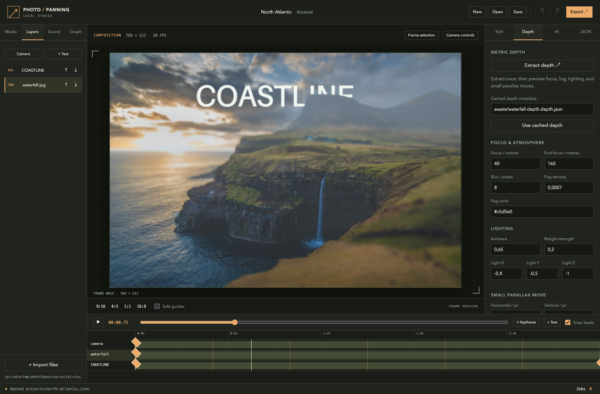

# Local Studio

Studio edits the same typed projects used by Python and the CLI. Camera
keyframes, layers, audio, masks, and model jobs stay in a saved JSON graph.



```bash
uv sync --frozen
uv run pic2panning studio --workspace ~/Pictures/Photo2Panning
```

The editor opens at `http://127.0.0.1:8765`. Choose another `--port` when
needed. `--no-open-browser` starts the server without opening a tab.
To browse the repository's existing example media, run from its root with
`--workspace .`.

## Build a composition

1. Import photos, video, and sound. Imports copy files into the workspace.
   Click a media asset to add it as a layer.
2. Select **Camera controls** to set the viewport center and zoom. Move the
   playhead, change a value, and add keyframes for the desired movement.
3. Select a layer to edit its center, scale, rotation, opacity, and timing.
   Use the layer arrows to change stacking order. **Text** adds a graphic
   that can move with the world canvas or stay in output coordinates.
4. Open **Sound** to mix music, voice, and ambience. Set source offsets,
   fades, gain, and looping. Beat analysis adds markers for keyframe
   snapping. Ducking lowers music or ambience under a declared voice track.
5. Choose an aspect ratio and inspect its framing. **Export** renders the
   movie, a smaller draft, or a social pack with matching stills.

For text, **Sentence morphs** adds timed target sentences. **Letter
entrance** drops glyphs through 3D before the first transition.
**Attach to image surface** selects a depth-enabled image and its
flat patch. Set free X/Y/Z angles under **3D orientation**. The
[typography guide](typography.md) shows both rendered examples and their
editable JSON jobs.

The player requests canonical still frames as the playhead moves. Movie
exports use the declared frame rate and audio mix. Previews reuse existing
media and cached depth; scrubbing does not start image generation or depth
inference.

Exposure sampling increases CPU render time. One local run of the bundled
eight-second story exported all three 1080-wide variants, three covers,
and 24 carousel frames in 18 minutes 51 seconds on the 36 GiB M3 Max.
It used 30 fps and eight samples at a 180-degree shutter angle. Use a draft
to check framing before exporting at full size. The GIF previews omit sound;
their linked MP4s retain the mix.

World coordinates use canvas pixels. A camera zoom of one maps the canvas
height to the output height. Viewport graphics use the composition's output
pixels; reframing moves their centers with each output axis and scales
their size uniformly with output width. See the
[composition contract](agent-tools.md#compose-layers-and-camera-keyframes)
for timing and coordinate details.

## Depth, selections, and local models

The **Depth** tab attaches a cached depth manifest to its matching image,
or queues a new extraction. Its controls adjust focus, fog, directional
lighting, and bounded parallax. A text or graphic layer can select another
depth-enabled image as its occluder. Keep all five depth artifacts together
when copying an asset into the workspace. The
[bundled depth example](depth.md) runs through the core install.

Painted masks use white for selected pixels. Image masks move with their
layer. Add a clean background plate beneath a moving subject so the
revealed area contains actual image content. For video, **Freeze outside
the motion mask** combines moving pixels with an explicit frozen source
frame. Mask dimensions must match the oriented source.

The **AI** tab provides FLUX 3 edits with ordered reference images,
context-crop repair, text-guided masks, and first/last-frame video. Each
job starts after pressing its run button. Install the required extra in
the same environment before using it:

| Operation | Extra |
| --- | --- |
| FLUX generation, repair, segmentation | `models` |
| Depth extraction | `camera` |
| LTX guided video | `video` |

Generated outputs become separate workspace assets. The input photo stays
protected. Inspect generated content and masks before exporting. See
[model controls and measured runs](models.md) for memory use and the
[precise repair example](../examples/repair-vehicles.json).

## Save and run projects

**Save** writes the editable graph under `projects/`. Revision checks
prevent one browser tab from silently replacing a newer saved version.
The **JSON** inspector validates the selected operation against the public
schema. The **Graph** panel exposes its dependencies and enabled state.

The jobs drawer shows queued work, elapsed time, outputs, errors, and
worker logs. Model jobs run serially; CPU previews have a separate worker
path. Canceling a job stops its process group. Completed intermediates
remain available for later runs through the verified project cache.

Studio confines media, project files, and outputs to its workspace.
Standalone Python and CLI jobs can use other explicit paths. The
[project guide](projects.md) explains dependency links, cache policies,
and execution reports.
