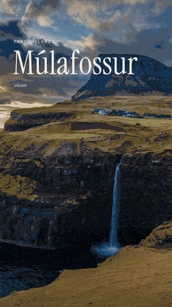

# Perspective text and letter animation

Text can follow a photographed surface, fall into place one letter at a
time, and change into another sentence. The same composition renders in
Studio, Python, and the CLI. Cached depth effects and 2D typography run
with the core installation on the CPU. Solid letter volumes also use an
installed Blender application with Cycles Metal.

## Editorial titles

[](../examples/media/waterfall-editorial.mp4)

The [editorial composition](../examples/compose-editorial.json) keeps the
main location title readable while the camera moves across one photograph.
The secondary label holds **VÁGAR**, fades while moving eight pixels up,
then introduces **GÁSADALUR** from eight pixels below. Separate text layers
declare the timing and opacity. All distances use the authored 1080-wide
viewport; draft reframing scales them together.

```bash
uv run pic2panning run examples/compose-editorial.json
uv run pic2panning run examples/preview-editorial.json
```

The 5.5-second movie is silent. The example selects Instrument Serif for
the main title and Manrope Medium for the small location text. Its fixed,
tracked **FAROE ISLANDS** kicker is a bundled transparent graphic. Main and
secondary titles remain editable `TextLayer` instances.

Use the [generator](../examples/make_editorial_demo.py) to write the jobs
or render a smaller 540×960 draft with `--draft --render`.

## Letters on a photographed table

[](../examples/media/table-letters.mp4)

```bash
uv run pic2panning run examples/compose-table.json
uv run pic2panning run examples/preview-table.json
```

The seven-second example drops **MAKE ROOM** onto a table, holds the
sentence, then reshapes it into **MAKE TIME**. Ivory letter volumes have
visible sidewalls, rounded bevels, and cast shadows. They begin at different
times and rotate around X, Y, and Z before settling. The renderer keeps
closed meshes during the fall, holds, and glyph transitions. Source-depth
geometry hides parts passing behind the cup or notebook.

The example sets `letter_drop.height` to `12` font heights so entrances
begin above the photo's top edge. The two-second drop leaves time for a
complete hold before the sentence changes at four seconds.

The photograph sits in a warm poster frame with a separate bottom safe
area. Its aspect ratio stays unchanged, and the landed caption remains
above the Story reply controls.

The [composition](../examples/compose-table.json) references the bundled
[photo](../examples/media/table.jpg) and its real
[depth manifest](../examples/media/table-depth/table.depth.json). Repeating
the render requires Blender with Cycles Metal and needs no model download
or extra Python model dependencies. To extract a replacement depth asset:

```bash
uv run --extra camera pic2panning run examples/table-depth.json
```

This extraction uses the explicit MPS device, 1,800 tokens, and a
768-pixel maximum edge. On a 36 GiB M3 Max, it produced a 513×768 grid from
the 1280×1917 photo in 30.77 seconds, with a 2.87 GiB peak process RSS.

## Solid letter volumes

Set `TextLayer.solid` to a `SolidText` configuration and attach the layer
to a calibrated `surface`. The renderer builds closed, beveled volumes
from the glyph contours and lights them in the fitted table's coordinates.
The table receives their cast shadows. Depth-derived foreground geometry
acts as a holdout when the photographed objects are nearer to the camera.

Install [Blender](https://formulae.brew.sh/cask/blender) with Cycles Metal:

```bash
brew install --cask blender
```

The executable must be Blender 4.2 or newer. Native proofs on this Mac use
4.2.1. The library discovers `blender` on `PATH`, then
`/Applications/Blender.app/Contents/MacOS/Blender`. Set `solid.executable`
to use another explicit installation. Missing Blender or Metal support
raises an error. Ordinary 2D text, the editorial example, and cached depth
effects render on the CPU without starting Blender.

An empty `"solid": {}` selects these defaults:

| Control | Default and meaning |
| --- | --- |
| `thickness` | `0.2` font heights, including the front and back bevels |
| `bevel` | `0.02` font heights; less than half the total thickness |
| `roughness` | `0.36`, from smooth `0` to rough `1` |
| `metallic` | `0`, with `1` for a fully metallic material |
| `samples` | `64` Cycles samples per rendered frame |
| `ambient` | `0.25` background illumination |
| `key` | Warm 12 W area light with a 0.4-metre emitter |
| `fill` | Warm 6 W area light with a 0.5-metre emitter; `null` disables it |

Lights stay fixed relative to the fitted patch while the letters move.
Each light's `position` uses metres along the patch's right, down, and
upward normal axes, measured from the patch centre. `size` is the circular
emitter's diameter. Increasing it softens shadow edges. `energy` uses
watts; `color` selects an opaque emitted color. Each light's normal
coordinate must be positive so it stays above the receiving surface.

Use an opaque text color and keyframe opacity for fades. Solid lettering
requires zero `stroke_width`, a zero `shadow_offset`, no text-layer `mask`, and
`blur: 0` on every text cue. Its materials, bevels, and lights supply the
appearance. These constraints validate before rendering.

## Attach text to depth

Set `TextLayer.surface` to a `SurfaceAttachment`. Its `layer_id` identifies
an earlier image layer with matching cached depth. `region` selects a
planar patch in the oriented source image, using exclusive right and
bottom edges. Choose the table itself and leave cups, books, and edges
outside the fitting patch.

The renderer unprojects the sampled depth with its calibrated intrinsics,
fits a plane, and projects the text back into the photograph. A rejected
fit raises an error. It does not substitute a flat screen overlay.

Surface-text keyframe `x` and `y` use the host image's source pixels.
Their camera rays intersect the fitted plane. `scale` changes physical
text width, and `rotation` rotates it within that plane. The host image
supplies its placement, camera movement, mask, opacity, and depth warp.

| Surface control | Meaning |
| --- | --- |
| `tilt`, `yaw`, `roll` | Rotation in degrees around the local surface axes |
| `offset_metres` | Additional displacement along the plane's right and down axes |
| `lift_metres` | Move toward the camera along the surface normal |
| `depth_tolerance_metres` | Depth separation tolerated before nearer pixels hide a 2D text plane |
| `feather_metres` | Depth interval used to soften a 2D plane's occlusion edge |
| `max_relative_error` | Largest accepted plane-fit RMS relative to sampled depth |

Surface text uses world space and automatic depth visibility. Its `surface`
field replaces a separate `occlusion` declaration. A single photo provides
estimated geometry; a curved or cluttered region may not fit one plane.
Solid lettering uses its actual letter volumes and source-depth holdout
geometry for visibility. The plane-only tolerance and feather controls
apply to 2D lettering.

## Drop letters through 3D

Add `letter_drop` to a text layer. The first sentence falls during the
first `duration` seconds of that layer's local timeline. `stagger` controls
the fraction of that interval used to start the glyphs in reading order.
The remaining interval lets every glyph finish its fall.

`height` uses font heights above the resting plane. `rotation` supplies
initial X/Y/Z angles that settle to the layer's declared pose. `bounce`
adds a bounded rebound. A surface attachment places this movement in the
depth camera's metric coordinates. With `solid`, each falling glyph keeps
its thickness and participates in the physical lighting. Free 2D text can
use a projected letter fall in its own perspective view.

Leave time after landing so the sentence can be read. Sentence transitions
must begin after the complete letter drop; overlapping intervals fail
validation.

## Morph between sentences

`TextLayer.text` contains the first sentence. Ordered `text_cues` describe
later sentences, with `at` measured from the layer's start:

```json
{
  "text": "CHASE THE\nCOAST",
  "text_cues": [
    {
      "at": 3,
      "text": "CHASE THE\nLIGHT",
      "transition": 1,
      "stagger": 0.25,
      "blur": 1.5,
      "travel": 0.55
    }
  ]
}
```

Matching glyphs move to their new positions. Changed glyphs reshape their
ink contours while traveling along curved paths. `stagger` spreads their
starts within the declared transition interval. `blur` controls temporary
softening for 2D text; solid lettering requires `blur: 0`. `travel` uses
font sizes. At the transition's end, the target sentence holds until
another cue. Solid glyph contours form closed, beveled meshes throughout
a transition.

The optional [multi-photo composition](../examples/compose.json) changes
its headline at 3 and 5.5 seconds, both on supplied 120 BPM markers. It
holds each completed sentence and uses an original instrumental track.
Inspect intermediate glyph shapes when choosing a font and transition.
The editorial example uses opacity and position keyframes for its small
labels and keeps its main heading steady.

## Free perspective text

Layer keyframes expose `rotation_x` and `rotation_y`, with `rotation` for
clockwise Z rotation. A positive `perspective` distance controls the
projection. Use a surface attachment when the angle must come from the
photographed table or another measured patch.

## Edit the animation in Studio

Select a text layer and open **Sentence morphs** to set each target
sentence, start, and transition. **Letter entrance** enables the 3D fall
and sets its initial X/Y/Z angles. **Attach to image surface**
selects the depth-enabled host and a flat patch in its source pixels.
The layer's **3D orientation** controls free perspective rotation.

After attaching text to a surface, **Solid letters** enables **Render
beveled 3D letters**. Set thickness, bevel, roughness, metallic response,
and samples. Its **Key light** and **Fill light** controls set power,
emitter diameter, metric position, and color. Solid previews use Blender
on Metal; flat text previews stay on the CPU.

Use the playhead to check a landing or transition, then export a draft.
Preview frames use the same renderer as the final movie. Reusing the
bundled depth does not start model inference.

## Source credits

The tabletop photo is by
[Pavel Danilyuk on Pexels](https://www.pexels.com/photo/coffee-cup-on-wooden-table-6763887/),
used under the [Pexels license](https://www.pexels.com/license/).
The examples bundle [Anton](https://github.com/googlefonts/AntonFont),
with its [SIL Open Font License](../examples/media/fonts/OFL.txt).
The editorial example uses
[Instrument Serif](https://github.com/google/fonts/tree/main/ofl/instrumentserif)
and a weight-500 instance of
[Manrope](https://github.com/google/fonts/tree/main/ofl/manrope), distributed
with their [Instrument Serif](../examples/media/fonts/InstrumentSerif-OFL.txt)
and [Manrope](../examples/media/fonts/Manrope-OFL.txt) licenses. These fonts
are selected explicitly in the jobs.
