# Photo2Panning

[](https://github.com/affromero/Photo2Panning/actions/workflows/quality.yml)
[](https://github.com/affromero/Photo2Panning/releases/latest)
[](https://docs.python.org/3.14/)
[](LICENSE)
[](docs/models.md)
[](https://docs.astral.sh/uv/)

Build photo and video stories in a local visual editor, or run the same
validated jobs from Python and the CLI. Animate a camera across a canvas
of photos, mix sound, and export social crops with matching covers.
Photo2Panning also reconstructs 3D scenes, reuses depth for image effects,
and runs local FLUX edits, precise region repairs, segmentation, and
image-guided video.

[Quick start](#quick-start) · [Studio](#local-visual-studio) · [Demos](#demos) ·
[Projects](docs/projects.md) · [Depth effects](#reuse-depth-for-focus-and-occlusion) ·
[FLUX edits](#change-the-season-with-flux) ·
[Photo transition](#connect-two-pexels-photos) ·
[Precise repair](#repair-the-two-remaining-vehicles) ·
[Two references](#combine-two-reference-photos) · [Features](#features) ·
[Python](#python-library) · [LLM tools](#llm-tools-and-json-jobs) ·
[Local models](#local-models)

| Photo pan | Zoom and return |
| :---: | :---: |
| [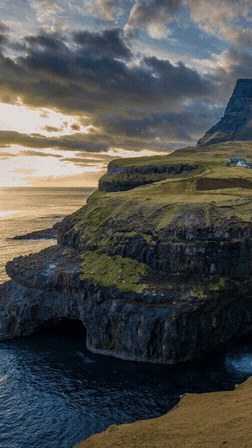](https://github.com/affromero/Photo2Panning/releases/download/v0.3.1/waterfall-pan.mp4) | [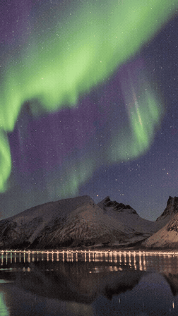](https://github.com/affromero/Photo2Panning/releases/download/v0.3.1/mountain-zoom.mp4) |
| **3D camera excursion** | **Photo-to-photo transition** |
| [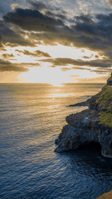](https://github.com/affromero/Photo2Panning/releases/download/v0.3.1/waterfall-camera-excursion.mp4) | 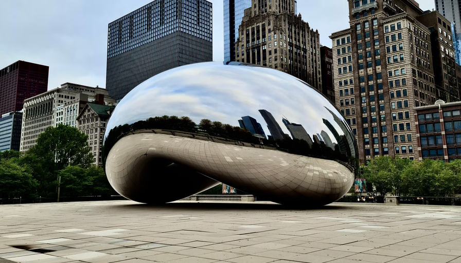<br/>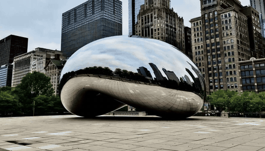<br/>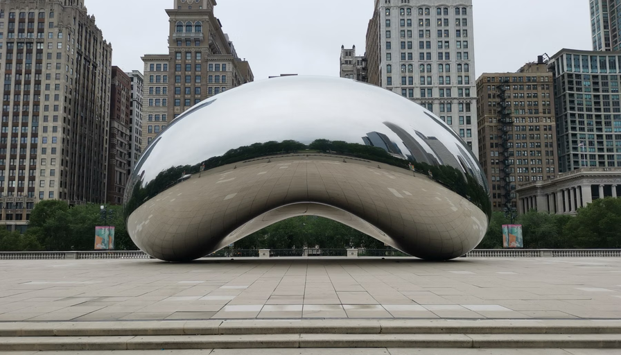 |

The pan and zoom previews show their complete motion; the camera preview
isolates its 3D excursion. Those examples link to 1080 by 1920, 60 fps
MP4s. The transition card shows its first guide, generated move, and last
guide from top to bottom. It uses two independent Pexels photos of Cloud
Gate at 896 by 512 and 24 fps. The examples below show the inputs and
results.

## Quick start

Requires an Apple Silicon Mac, [uv](https://docs.astral.sh/uv/getting-started/installation/),
and [Homebrew](https://brew.sh/).

```bash
brew install ffmpeg
git clone https://github.com/affromero/Photo2Panning.git
cd Photo2Panning
uv sync --frozen
uv run pic2panning --help
```

`uv` installs the pinned Python 3.14.9 interpreter and creates `.venv`.
Photo motion, video processing, and ordinary image edits work with this
core installation. Try either public photo below.

## Local visual Studio

```bash
uv run pic2panning studio --workspace ~/Pictures/Photo2Panning
```

[](docs/studio.md)

Studio opens at `http://127.0.0.1:8765`. Import media, place image, video,
and text layers, then set camera and layer keyframes on the timeline.
The same workspace holds audio tracks, painted selections, cached depth,
and explicit AI jobs. Imports preserve the original files.

Preview frames use the canonical compositor. Scrubbing reuses existing
media and cached depth; model inference starts from a run button. Saved
projects retain their operation graph and reuse verified intermediates.
The jobs drawer provides progress, cancellation, outputs, and errors.
See the [Studio guide](docs/studio.md) and
[saved-project contract](docs/projects.md).

## Demos

### Compose a story across several photos

[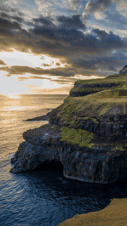](examples/media/social-story.mp4)

```bash
uv run pic2panning run examples/compose.json
uv run pic2panning run examples/preview.json
uv run pic2panning run examples/social-pack.json
```

The eight-second composition moves across the coast and aurora photos,
pauses on a camera pose, and fades viewport text over an original 120 BPM
soundtrack. The social pack renders portrait, feed, and square movies with
a cover and carousel stills from the same canvas. Its music is synthesized
by [the example script](examples/make_social_demo.py) and distributed under
this repository's MIT license.

The [composition](examples/compose.json), [social pack](examples/social-pack.json),
and [cached project](examples/project.json) are ordinary JSON jobs.
They use the core install. The project prepares an image before rendering
its selected target, with source hashes and cache hits in its report.

### Reuse depth for focus and occlusion

[](examples/media/depth/waterfall-depth-motion.mp4)

This complete three-second example uses a bundled float32 depth map for
rack focus, fog, directional lighting, and small parallax. The title moves
behind foreground geometry. Rendering it needs no model weights:

```bash
uv run pic2panning run examples/compose-depth.json
```

The [depth guide](docs/depth.md) includes the metric TIFF, preview, normals,
foreground mask, and source-bound manifest. Extract another asset with
the `camera` extra and [depth job](examples/depth.json). On an M3 Max, a
360×240 frame using cached depth rendered in 0.073 seconds.

### Pan across Múlafossur waterfall

| Source photo | Rendered pan |
| :---: | :---: |
| 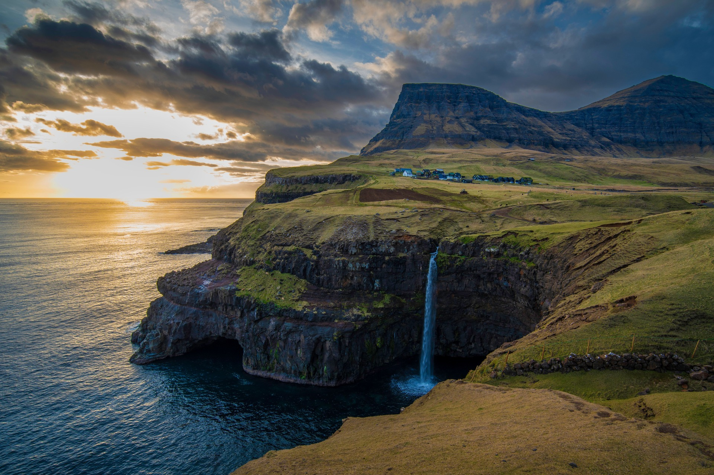 | [](https://github.com/affromero/Photo2Panning/releases/download/v0.3.1/waterfall-pan.mp4) |

[Original photo on Pexels](https://images.pexels.com/photos/29188556/pexels-photo-29188556/free-photo-of-stunning-sunset-over-mulafossur-waterfall-faroe-islands.jpeg).

```bash
uv run pic2panning render examples/media/waterfall.jpg \
  --output waterfall-pan.mp4 --motion panning-lr \
  --duration 7.5 --size 1080 1920 --fps 60 \
  --shutter-angle 180 --crf 16 --preset slow
```

### Zoom into the mountains and return

| Source photo | Rendered zoom and return |
| :---: | :---: |
| 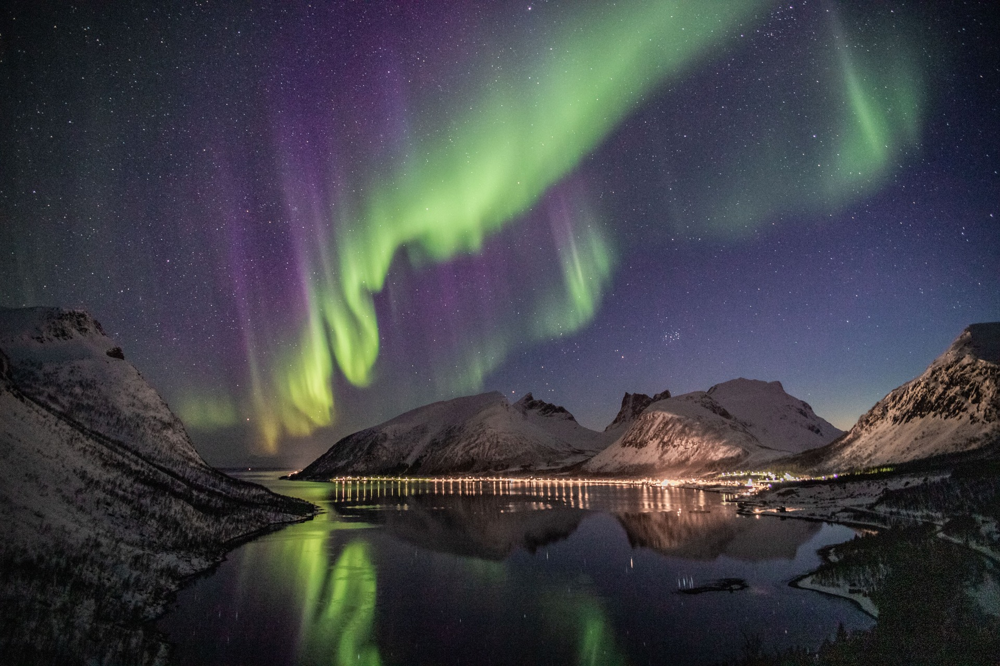 | [](https://github.com/affromero/Photo2Panning/releases/download/v0.3.1/mountain-zoom.mp4) |

[Original photo on Pexels](https://images.pexels.com/photos/2113566/pexels-photo-2113566.jpeg).

```bash
uv run pic2panning render examples/media/mountains.jpg \
  --output mountain-zoom.mp4 --motion zoom-in --zoom 1.5 --reverse \
  --duration 4 --size 1080 1920 --fps 60 \
  --shutter-angle 180 --crf 16 --preset slow
```

The waterfall and mountain photos are resized copies of the original
public demos. Source photos follow the
[Pexels license](https://www.pexels.com/license/), with credits beside
their examples.

### Pan, pause, move a 3D camera, and resume

[](https://github.com/affromero/Photo2Panning/releases/download/v0.3.1/waterfall-camera-excursion.mp4)

This animation shows the camera excursion itself. The near cliff and
distant mountain shift by different amounts. The complete video pans to
this view, moves the camera 2 metres right and 1.5 metres forward, returns,
then resumes panning. Distances use the model's estimated scene scale.

Install the camera tools and reconstruct a reusable scene from the photo:

```bash
uv sync --frozen --extra camera
uv run --extra camera pic2panning scene examples/media/waterfall.jpg \
  --output waterfall.ply --metadata waterfall-scene.json --max-edge 1920

uv run --extra camera pic2panning camera examples/media/waterfall.jpg \
  --scene waterfall.ply --metadata waterfall-scene.json \
  --pause-at 0.6 --before 4 --duration 5 --after 3.2 --hold 0.25 \
  --position 2 0 1.5 \
  --output waterfall-camera.mp4 --crf 16 --preset slow
```

MoGe-2 predicts metric depth and camera intrinsics locally on MPS. The
first scene downloads a pinned 1.32 GB checkpoint. The model card declares
MIT licensing; DINOv2 components use Apache 2.0. See
[camera models and measured runs](docs/models.md#camera-scenes).

The camera moves through source-colored Gaussian geometry, returns to its
original pose, and resumes the photo pan. Pans and pause endpoints use the
original photo; short handoffs blend in linear light. Video compression
changes output pixels slightly. Inferred depth supports modest moves;
larger excursions can reveal missing surfaces or soften details.

`--max-edge` limits geometry resolution while retaining the original photo
for the pans. Reuse the PLY and JSON for later camera renders. The metadata
binds them to the source photo's checksum.

### Change the season with FLUX

[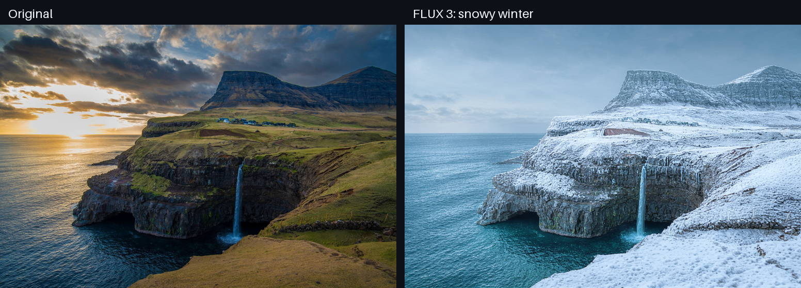](examples/media/waterfall-winter.png)

FLUX 3 edits the reference photo directly from a prompt. This example asks
for deep winter while retaining the viewpoint, waterfall, and coastline.
No segmentation mask is needed. The entire image can change.

```bash
uv sync --frozen --extra models
uv run --extra models pic2panning run examples/generate.json
```

The [job](examples/generate.json) includes the complete prompt and model
settings: 4-bit weights, 16 steps, seed 7, and 768 by 512 output. Its
bundled reference is resized from the original waterfall photo.

### Replace the sky with SAM and FLUX

[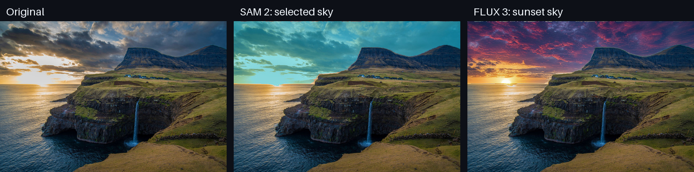](examples/media/waterfall-sunset.png)

Grounding DINO finds the sky from a text query, and SAM creates the
selection shown in cyan. FLUX 3 generates the requested violet and gold
sunset. The library composites the generated sky over the original using
that mask. In the resulting PNG, every pixel outside the selected region
stays identical to the reference.

```bash
uv run --extra models pic2panning run examples/mask.json
uv run --extra models pic2panning run examples/generate-masked.json
```

The [mask job](examples/mask.json) selects the sky on the CPU. The
[edit job](examples/generate-masked.json) uses that mask and the same
768 by 512 reference. Both FLUX examples above ran locally on this Mac.
The job saves a black-and-white mask; cyan identifies the selection in
the preview.

FLUX 3 uses a reference edit followed by compositing. For generation
conditioned on the masked area itself, select `flux1-fill`. See
[masked editing controls](docs/models.md#flux-generation-and-editing).

<details>
<summary>Selection and full-resolution results</summary>

[Sky selection overlay](examples/media/waterfall-sky-selection.jpg) ·
[Binary mask](examples/media/waterfall-sky-mask.png) ·
[Winter PNG](examples/media/waterfall-winter.png) ·
[Sunset PNG](examples/media/waterfall-sunset.png)

</details>

### Abandon a busy street with FLUX 3

[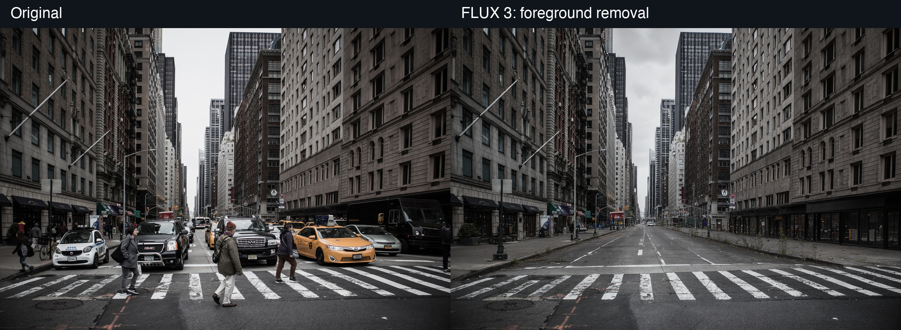](examples/media/street-result.png)

Turn a crowded Manhattan avenue into an abandoned city. FLUX 3 removes
the foreground pedestrians and traffic, reconstructs the road and
sidewalks, and adds cracked pavement, curbside weeds, and moody light.
The same buildings, viewpoint, and foreground crossing remain recognizable.

```bash
uv run --extra models pic2panning run examples/edit-empty-street.json
```

The [job](examples/edit-empty-street.json) uses local FLUX 3 with 4-bit
weights, 16 steps, and seed 7 at 1024 by 688. It edits the whole reference
image without a segmentation mask, so pixels across the image can change.
Two small vehicles remain in the distance in this result.

Photo: [Clément Proust, Pexels](https://www.pexels.com/photo/busy-new-york-city-street-scene-with-crosswalk-36286355/).

### Repair the two remaining vehicles

[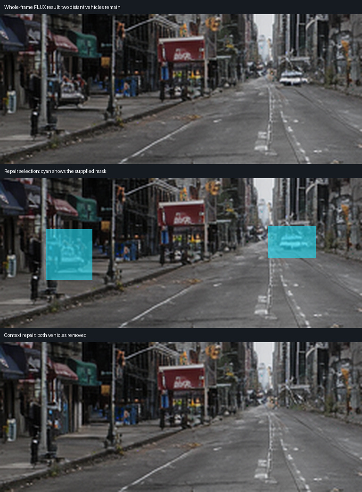](examples/media/repair/street-repaired.png)

The context-crop repair targets those two distant vehicles in the existing
FLUX result. It enlarges a source-pixel region with surrounding context,
runs FLUX 3 locally, and composites the repaired pixels through the supplied
mask. Both vehicles are removed in this native result. All 702,731 pixels
outside the mask remain byte-identical to the input PNG.

```bash
uv run --extra models pic2panning run examples/repair-vehicles.json
```

The [job](examples/repair-vehicles.json) uses the 1024×688 FLUX result,
64 pixels of context, a 768-pixel model edge, three-pixel inward feathering,
4-bit weights, 16 steps, and seed 7. It took 175.15 seconds with a
19.15 GiB peak footprint on the 36 GiB M3 Max. The comparison enlarges
the selected area; inspect the [full PNG](examples/media/repair/street-repaired.png)
and [binary mask](examples/media/repair/vehicle-mask.png) for exact pixels.

### Combine two reference photos

[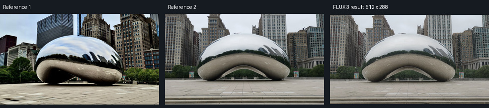](examples/media/references/bean-two-references.png)

FLUX 3 accepts ordered reference images. These two public Cloud Gate
photographs condition one generated view with the sculpture, plaza, and
reflections. The result is a new image whose details can differ from both
guides.

```bash
uv run --extra models pic2panning run examples/generate-references.json
```

The [job](examples/generate-references.json) uses both images in `references`,
4-bit weights, 16 steps, seed 7, and 512×288 output. The native two-image
run took 147.96 seconds with a 24.30 GiB peak footprint. The API accepts
up to ten conditioning images total, with an optional `source` counted
first. This measured example exercises two. The same public guides and
their credits appear in the [video example](#connect-two-pexels-photos).

## Features

| Tool | Controls |
| --- | --- |
| Local Studio | Timeline, layer controls, canonical previews, saved JSON, queued jobs |
| Compositions | Multiple photos, camera holds and easing, text and graphic transforms |
| Projects and cache | Explicit dependencies, source hashes, verified intermediate reuse |
| Depth effects | Metric extraction, rack focus, fog, lighting, parallax, text occlusion |
| Selective motion | Painted or segmented image masks, clean plates, video cinemagraphs |
| Photo motion | Four pan directions, zoom, return path, slower center motion |
| 3D camera | Local scene reconstruction, calibrated excursion, return and resumed pan |
| Video | Crop to a new aspect ratio, bouncing pan, zoom, playback speed |
| Generated video | Local LTX shot guided by a first and last photo |
| Audio and titles | Retain source sound, replace or loop music, add title cards |
| Audio editing | Music, voice and ambience mixing, gain, fades, ducking, beat markers |
| Image editing | Crop, resize, rotate, flip, brightness, contrast, saturation |
| Local models | Ordered FLUX 3 references, context-crop repair, masked fill, segmentation |

Sizes use **width, height**. `1080 1920` produces a 9:16 portrait video;
`1920 1080` produces 16:9 landscape. Images retain their proportions and
crop to fill the frame. Video reframing respects display rotation and
pixel aspect ratio. MP4 dimensions must be even.

### Motion and export quality

| `--motion` | Movement |
| --- | --- |
| `panning-lr`, `panning-rl` | Left to right, right to left |
| `panning-ud`, `panning-du` | Top to bottom, bottom to top |
| `zoom-in`, `zoom-out` | Toward the center, away from the center |

For photos, `--duration` sets the forward motion. `--reverse` appends the
return path and `--focus-center` slows movement near the center. `--zoom`
sets the closest magnification and defaults to `4/3`.

`--shutter-angle 180` samples half a frame interval to soften motion along
its direction and reduce strobing during fast pans. Angles range from 0 to 360;
the default `0` keeps instantaneous frames. An enabled shutter renders
eight samples per interior photo frame, increasing render time. The first
and last frames stay sharp. The `render` command applies this option only
to photos. Compositions expose their own
[motion-exposure controls](docs/agent-tools.md#compose-layers-and-camera-keyframes).

Choose timing explicitly: `--duration 7.5 --fps 60 --shutter-angle 180`
combines a slower photo pan with more output frames and motion exposure.
Results depend on the scene, movement speed, and playback display.

MP4 exports use H.264. `--crf` controls detail: lower values produce larger
files. The default is `18`. `--preset` controls compression effort and
accepts `veryfast`, `fast`, `medium`, `slow`, or `veryslow`. The default is
`veryfast`; the demos use `slow` for the final export.

GIF output requires an explicit frame rate that divides 100 exactly:
`1`, `2`, `4`, `5`, `10`, `20`, `25`, `50`, or `100`.

```bash
uv run pic2panning render photo.jpg \
  --output pan.gif --motion panning-lr --duration 3 --fps 20
```

### Video, music, and title cards

Use `--video` for footage. Speed changes preserve the pitch of retained
audio. A video pan bounces at the source edges; `--pan-speed` sets movement
in output pixels per frame and defaults to `5`.

```bash
uv run pic2panning render walk.mp4 \
  --video --speed 2 --output walk-fast.mp4

uv run pic2panning render wide.mp4 \
  --video --motion panning-lr --output wide-portrait.mp4

uv run pic2panning render examples/media/waterfall.jpg examples/media/mountains.jpg \
  --output trip.mp4 --motion zoom-in \
  --audio music.m4a --audio-start 12 --loop-audio \
  --cover "A weekend away"

uv run pic2panning inspect trip.mp4
```

Multiple sources appear in input order. The CLI applies the same options
to each source; Python requests and JSON jobs support separate clip
settings. Original video sound stays unless you replace it or set
`keep_audio=False` in a request.

A global soundtrack spans the complete timeline, including title cards.
Per-clip soundtracks apply to their own clips. Short tracks end in silence
unless looping is enabled. An audio offset excludes the skipped prefix
from every repeat. Title cards keep their own duration.

For YouTube audio, install its optional dependency with
`uv sync --frozen --extra youtube`, then pass the URL to `--audio`.

### Soundtrack a finished video

```bash
uv run python examples/add_music.py --help
uv run python examples/add_music.py story.mp4 music.m4a \
  --output story-scored.mp4 --start 12 --loop
```

The example copies the video stream without recompression and replaces any
existing soundtrack. The audio input can also be an HTTP URL. The selected
track starts at `--start` and is trimmed or padded with silence to match
the video duration. `--loop` repeats it from that offset. Existing outputs
require `--overwrite`. You can also upload a silent video and add music in
Instagram.

### Edit a picture

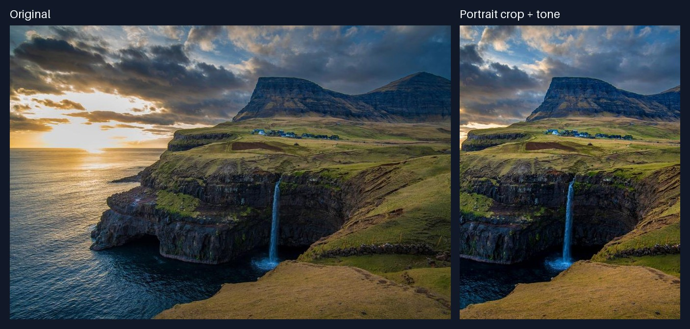

```bash
uv run pic2panning edit examples/media/waterfall.jpg \
  --crop 680 0 1640 1280 --resize 450 600 \
  --brightness 1.12 --contrast 1.08 --saturation 1.1 \
  --output waterfall-edited.jpg
```

Crop coordinates are `left top right bottom` in source pixels. The CLI
applies crop, resize, rotation, flip, then adjustments. Rotation uses
counterclockwise degrees and expands the canvas. Flip accepts `horizontal`
or `vertical`. Adjustment factors use `1` for no change. JSON jobs let you
choose the operation order.

## Python library

```python
from pic2panning import render
from pic2panning.schemas.base import Size
from pic2panning.schemas.media import ImageClip, Motion, RenderRequest

result = render(
    RenderRequest(
        clips=(
            ImageClip(
                source="examples/media/waterfall.jpg",
                duration=5,
                motion=Motion.PAN_LR,
            ),
            ImageClip(
                source="examples/media/mountains.jpg",
                duration=3,
                motion=Motion.ZOOM_IN,
            ),
        ),
        output="trip.mp4",
        size=Size(width=1080, height=1920),
        fps=30,
    )
)
print(result.model_dump_json(indent=2))
```

The public functions include `render`, `reconstruct_scene`, `render_camera`,
`edit`, `generate`, `generate_video`, `mask`, `repair`, `extract_depth`,
`compose`, `preview`, `detect_beats`, `social_pack`, `run_project`, and
`run_job`.
Requests validate before processing. Results include
output paths, dimensions, and timing when applicable. Existing outputs
require `overwrite=True` or `--overwrite`. Input aliases stay protected.

## LLM tools and JSON jobs

Start with [llms.txt](llms.txt) and the [tool guide](docs/agent-tools.md).
The CLI generates its JSON Schema from the same request models the Python
library uses:

```bash
uv run pic2panning schema > job.schema.json
uv run pic2panning validate examples/render.json
uv run pic2panning run examples/render.json
```

A job selects its operation with `kind`: `render`, `scene`, `camera`,
`edit`, `generate`, `generate-video`, `mask`, `depth`, `compose`, `preview`,
`beats`, `repair`, `social-pack`, or `project`.
Unknown fields fail validation. `validate` checks the request without
reading media or loading models. Commands write JSON results to stdout
and return a nonzero exit status on failure. Standalone paths resolve from
the process working directory. Project nodes use `ProjectRequest.workspace`.

Examples: [render](examples/render.json), [image edits](examples/edit.json),
[scene reconstruction](examples/scene.json),
[camera timeline](examples/camera.json),
[image generation](examples/generate.json),
[masked image editing](examples/generate-masked.json),
[video generation](examples/generate-video.json),
[segmentation](examples/mask.json), [context repair](examples/repair-vehicles.json),
[ordered references](examples/generate-references.json),
[depth](examples/depth.json), [composition](examples/compose.json),
[preview](examples/preview.json), [beats](examples/beats.json),
[social pack](examples/social-pack.json), [cached project](examples/project.json).

## Local models

Install model dependencies with `uv sync --frozen --extra models`.
Weights download on first use. The [winter edit](#change-the-season-with-flux)
and [selected sky edit](#replace-the-sky-with-sam-and-flux) show actual
results with runnable jobs.

FLUX 3 Image Klein uses quantized MLX weights on Metal. It supports
4, 6, and 8-bit weights; the default is 4-bit. Source images are optional
for generation. Width and height must be multiples of 16.

Grounding DINO Tiny and SAM 2.1 Tiny create masks on the CPU. Masks use
white for the region to edit and black for the region to retain.
Source, mask, and output dimensions must match for masked edits. Masks and
masked edits require PNG. Other image outputs support PNG, JPEG, and WebP.
Use a mask with `flux1-fill` or FLUX 3; see
[masked editing controls](docs/models.md#flux-generation-and-editing).
Some weights require Hugging Face authentication and acceptance of the
model terms. See [local model setup and measured runs](docs/models.md).

### Connect two Pexels photos

| First image guide | Generated transition | Last image guide |
| :---: | :---: | :---: |
|  |  |  |

The `video` extra adds local LTX-2.3 generation on MLX. Its two stages use
the first and last photos as image guides. These are two independent
photos of Chicago's Cloud Gate, taken from different viewpoints. The job
asks for a camera arc from the three-quarter view toward the front of
the sculpture, with changing reflections and background parallax.
Generated endpoints can differ from the input pixels.

This run includes a generated pole crossing the foreground and wobbling
building details. Inspect intermediate frames as well as the endpoints.

```bash
uv sync --frozen --extra video
uv run --extra video pic2panning run examples/generate-video.json
```

The [job](examples/generate-video.json) includes the prompt, seed, and
both guide paths. Its output is a silent 896 by 512 MP4 with 49 frames
at 24 fps, lasting about 2.042 seconds. Inputs are center-cropped to fit; use
`edit` first to choose another framing. Width and height must be multiples
of 64, and frame counts must be `8k + 1` with at least 9 frames. The first
default run downloads about 40 GB of model weights.
Local input images stay on this Mac. See
[video models and controls](docs/models.md#first-and-last-frame-video).

Photos: [Enrique Cortes](https://www.pexels.com/photo/modern-cloud-gate-sculpture-in-a-chicago-17010678/)
and [Alberto E](https://www.pexels.com/photo/cloud-gate-chicago-8877910/),
under the [Pexels license](https://www.pexels.com/license/).

## Development

```bash
uv sync --frozen --extra camera
uv run --extra camera pre-commit install
uv run --extra camera pre-commit run --all-files
uv run --extra camera mypy
uv run --extra camera pytest
uv build
```

Ruff checks style and formatting. `ty` checks types at commit time; strict
mypy also runs in CI. The camera dependencies allow both tools to check
the optional adapters; installing them does not download model weights.
Tests inspect image content and real FFmpeg output. Model execution checks
and memory measurements are documented in [local models](docs/models.md).

Demo entry points in [`pic2panning/demos`](pic2panning/demos) use the same
CLI and processing functions. See [AGENTS.md](AGENTS.md) for contributor
rules and [LICENSE](LICENSE) for the MIT license.
